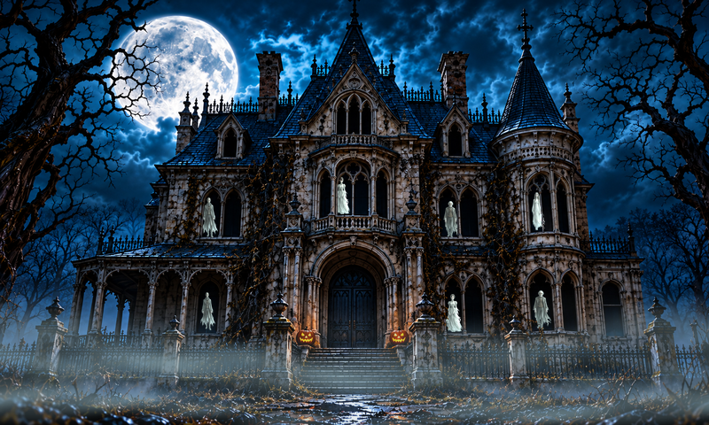

# Moonwake Manor

A quiet, animated haunted mansion for an 800×480 landscape HDMI display and the original Raspberry Pi Zero W. It is an alternate display in the Little Night Shift project; the robot night-light remains in the repository root.



## The scene

- A moonlit mansion, graveyard, pumpkins, and three dense drifting foreground fog layers.
- Room lights that change and flicker quietly, apparitions inside masked windows, bats, curtains, attic eyes, and occasional silhouettes.
- Three major haunting variants: window ghosts, a slowly opening front door, and a large shadow moving behind the upstairs windows.
- **Startup showtime:** about 15 seconds after the scene starts, the window haunting plays once. Interior and porch lamps dim over 2.4 seconds, lightning reveals ghosts, and the lights gradually return. The moonlit building and grounds stay visible.
- Normal random event timing resumes after showtime. No internet, Wi-Fi, account, sound, or external service is required at runtime.

This folder contains the current v6-based scene running on the Pi, including the denser fog and moonlight correction. It does not replace or alter the robot program.

## Run on Raspberry Pi

Use Raspberry Pi OS **32-bit with a graphical desktop** on an original Zero W. The display should already be configured for 800×480 landscape; these files do not change boot settings or HDMI timings.

```sh
sudo apt update
sudo apt install -y python3-pygame
git clone https://github.com/wopr-display-lab/little-night-shift.git
cd little-night-shift/moonwake-manor
sh start.sh
```

The launcher unpacks `assets.zip` on the first run. The archive contains the ready-to-run backgrounds and sprites under `assets/`; no artwork generation or network download is required. Large unused source-art images are omitted. Python 3 and Pygame are the only runtime dependencies.

If cloning is inconvenient, download the repository ZIP from GitHub, extract it, and run `sh start.sh` from this folder. Keep the folder intact.

## Controls and options

| Key / option | Action |
| --- | --- |
| Space / H | Trigger a random major haunting |
| 1 / 2 / 3 | Trigger windows / door / shadow haunting |
| L | Lightning |
| Esc / Q | Exit |
| `--no-startup-showtime` | Skip the one-time startup performance |
| `--no-flashes` | Omit visible lightning flashes |
| `--demo` | Faster event schedule cycling through the variants |
| `--fps 10` | Lower frame cap; default is 15 FPS |
| `--windowed` | Windowed desktop preview |

```sh
sh start.sh --no-startup-showtime
sh start.sh --no-flashes
```

The frame cap is a maximum, not a performance guarantee. This scene uses software compositing and can run below the cap on a Zero W. Sprites, fog scaling and shadow frames are prepared at startup; per-frame work uses cached artwork. Startup can take a while on the original Pi.

## Start at desktop login

Test the scene first. Back up your desktop startup configuration, then disable the robot's startup entry before enabling the mansion so they do not compete. Keep the robot's files for switching back.

```sh
cd ~/little-night-shift/moonwake-manor
python3 autostart.py --desktop xdg
```

Use `--desktop labwc` if you specifically want its startup file instead. The helper preserves unrelated labwc lines and manages only the mansion's own entry. Run it as your desktop user, without sudo. Desktop auto-login and disabled screen blanking are configured separately in Raspberry Pi OS.

```sh
python3 autostart.py --remove
```

Logs go to `~/.local/state/moonwake/display.log`. A launch lock prevents duplicate copies. Running from SSH requires the graphical session's display environment; the desktop startup entry handles it automatically.

To restore the robot: remove the mansion's startup entry, restore/re-enable the saved robot startup entry, and exit the mansion or log out and back in. Neither project deletes the other's files.

## Tests

Extract artwork before running the tests directly:

```sh
python3 -m zipfile -e assets.zip .
python3 -m unittest -v test_startup_showtime test_timeline test_rooms
```

All ten tests pass: seven startup/timing tests, including a two-hour simulated schedule, and three room tests for sprite sizes, window masks, and shared room timers. The room tests were also run on the target Pi. The screenshot is a direct capture of the running Pi after the fog and moonlight changes. The automatic startup event was confirmed in its live log; a complete reboot test after these latest changes has not been performed.

To make a headless snapshot on a development machine with Pygame:

```sh
python3 haunted.py --headless --fast-test --fps 10 --seconds 20 --snapshot preview.png
```

## Artwork

The bundled runtime artwork was AI-generated and prepared for this project, with masked room sprites and composited animation layers. The running scene does not call an AI service. It is an original haunted-house display, not an official Disney Haunted Mansion product.
